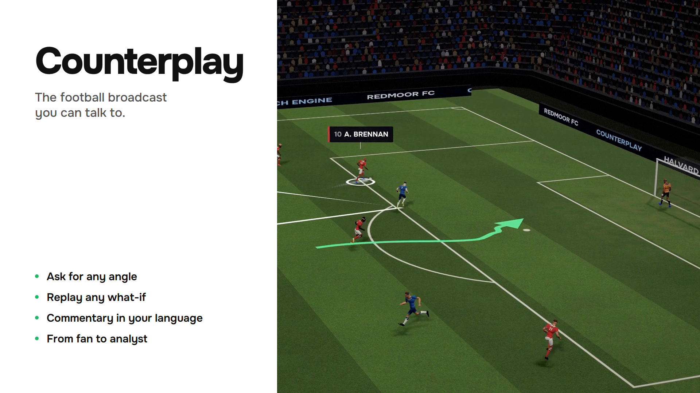
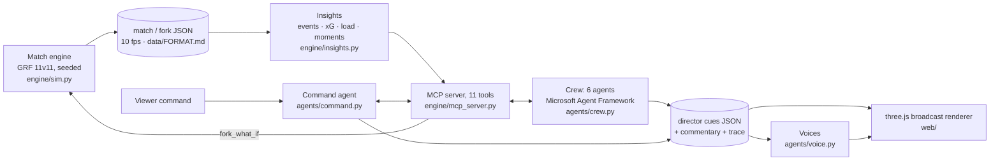

# Counterplay

**The football broadcast you can talk to.** Ask for an angle, a language, a level of tactics or a what-if, and a crew of AI agents rebuilds the broadcast for you, using only numbers the match engine can back up.



**[Demo video (2 min)](https://youtu.be/Qsnvh5TnJtM)** · **[Live demo](https://musti7even.github.io/counterplay/)** (desktop Chrome/Edge, no login) · [](https://github.com/Musti7even/counterplay/actions/workflows/ci.yml)

Built for the Microsoft "Inside the Game" hackathon (category: Best Multi-Agent System). All match data is synthetic.

## The problem

A broadcast is one feed for millions of viewers. Every extra version (another language, a tactics cut, a player cam, a what-if) costs a producer, an analyst and hours, so everyone gets the same average version. The expensive part is not the pictures but the crew deciding what to show and explaining it. Counterplay gives that job to agents. They write a timed script, the renderer plays it, and so one more version costs one more script.

## What you can ask it

These are the commands from the demo video. Each one becomes real tool calls (`data/commands/<n>.json`).

| you say | Command agent calls | the broadcast |
|---|---|---|
| "Minute sixty-nine. Watch this." | `seek(63.0)` | jumps to the build-up to the goal |
| "Show me that goal from four angles." | `set_view("angles4")` | four synced cameras |
| "It's Sørensen's fault. Show me what happens if he steps up." | `fork_what_if(at=66.5, tweak="step_up", player="a6")` | the engine re-simulates from 66.5 s; split/ghost view, **1–0 becomes 0–0** |
| "Make the commentary simple." | `set_commentary_level("simple")` | casual persona and lens |
| "Now in Spanish." / "How would a German commentator call it?" | `set_language("es")` / `set_language("de")` | localized commentary and voice |
| "I want the full tactics." | `set_commentary_level("expert")`, `highlight_players(["h8","a6"])` | analyst lens: back line, pressing, pass lanes |

On the live site you can try the four results directly: **the what-if**, **fan to analyst**, **every fan** (four personas on one clock) and the **AI gallery** (the agent trace replayed next to the picture, including a recovery from a failed agent).

## How it works



The five stages of the brief, mapped to code:

| stage | what happens | code |
|---|---|---|
| **Ingest** | Google Research Football plays a full 11v11 match on its built-in AI. The run is deterministic per seed and recorded at 10 fps. GRF can snapshot its full state, so any moment can be forked: one player gets one tweak (`step_up`, `hold_line`, `sprint`, `pass_early`, `shoot`) and the engine plays the rest out. | `engine/sim.py` |
| **Interpret** | Events, pass difficulty, xG, sprints, synthetic heart rate, possession, line height, pressing, control vs chaos, and ranked moments, each with evidence ids. Pure numpy. | `engine/insights.py` |
| **Explain** | The agents read the match only through MCP tools. No agent sees raw data. | `engine/mcp_server.py`, `agents/crew.py` |
| **Render** | A three.js renderer plays a director cue script: camera cuts, slow-mo, split and ghost what-if views, a casual-to-tactical lens, captions and graphics on the grass. | `web/src/director.ts`, `web/src/main.ts` |
| **Personalize** | Persona (casual, analyst, or one player in the second person) and language (en, es, tr, de) change what airs and how it is said, with voices. | `agents/crew.py`, `agents/phrases.py`, `agents/voice.py` |

Agents never render pixels. They write a timed JSON script (`{t, cam, cut, lens, speed, view, select, caption}`), and the renderer folds it frame by frame. That is why a new version is cheap and why recording is frame-exact.

## Agents

Six crew agents run as a Microsoft Agent Framework `WorkflowBuilder` chain and pass one shared board along. The Command agent is separate: it turns one viewer instruction into tool calls and cues.

| agent | role | tools it calls | on failure |
|---|---|---|---|
| Analyst | picks the moments that matter for this persona | `get_moments`, `explain_evidence`, `get_player`, `get_window_stats`, `get_match_state`; for a player persona also `get_player_events`, `get_player_snapshot` | 60 s timeout, 1 retry, then the template path |
| Tactician | explains why: control vs chaos, pressing, line height, line-breaking passes | `get_window_stats`, `get_player_snapshot` | 60 s, 1 retry, then template |
| What-If | reuses or creates a fork of the key moment and reads the score in both timelines at the same match time | `list_forks`, `fork_what_if`, `compare_fork`, `get_player`, `get_match_state` | 240 s, 1 retry, then template |
| Fact-checker | checks every number; re-reads the what-if score pair from both matches | `get_match_state` (re-reads both scores), plus the evidence store of every earlier tool output | the deterministic gate always runs, LLM or not |
| Producer | decides what airs and when; writes the director cues | none (works on the verified board) | 60 s, 1 retry, then template |
| Localizer | commentary and captions per language and persona | none | 90 s, 1 retry, then template; a line with an unverified number is replaced by the verified template line |
| Command | viewer instruction → `seek`, `set_view`, `fork_what_if`, `set_persona`, `set_language`, `set_commentary_level`, `highlight_players` | `get_roster`, `list_forks`, `fork_what_if`, `compare_fork`, `get_match_state` | LLM failure → transparent keyword/regex router (`mode: "rules"`) |

Every handoff, tool call, retry and fallback is written to `data/<run>.trace.json` while the crew runs. The web gallery (`&control=1`) replays it.

## MCP tools

`engine/mcp_server.py` is a FastMCP server (official `mcp` SDK), over stdio or streamable HTTP. Tools take `match` (`"match"` or a fork name); `compare_fork` takes the fork name.

| tool | returns |
|---|---|
| `get_match_state(t)` | score, mode, ball, owner, all positions, events and team stats of the last 10 s |
| `get_window_stats(t0, t1)` | possession, line height, compactness, pressing, turnovers, control/chaos, momentum |
| `get_moments(top_k)` | ranked moments (goal, big chance, line-breaking pass, pressing spell, momentum swing, sprint milestone) with evidence |
| `get_player(id, t0, t1)` | distance, top speed, sprints, synthetic heart rate, 1 Hz series |
| `get_roster()` | both squads, to resolve names like "Sørensen" to ids |
| `get_player_events(id)` | a player's passes, shots, tackles, interceptions, and tackles he lost |
| `get_player_snapshot(id, t)` | position vs own goal and back line, distance to ball, nearest opponent, speed |
| `explain_evidence(event_id)` | metrics for an event `e<N>` or moment `m<N>`, the frame around it, linked events |
| `list_forks()` | existing what-if forks of a match |
| `compare_fork(fork)` | goals prevented or created, score, player displacement vs the original |
| `fork_what_if(at, tweak, player, len, secs)` | re-simulates from `at` with one tweak (takes 3–15 s), writes the fork and its insights, returns the divergence |

A real transcript of these calls is in [`engine/README.md`](engine/README.md#insights--mcp-server-agent-layer).

## Trust and safety

An AI that invents a stat on air is worse than no AI. So:

- **Engine-backed numbers only.** Every MCP output is remembered as evidence. The fact-check gate (`verify` in `agents/crew.py`) rejects any claim with a number that no tool returned (rounded to 0.1), and lists it in the trace with the reason.
- **No data from the future.** Each tool output is stamped with the latest match time it depends on. A line airing at `t` may only use evidence known by `t` (`asof <= t`). Whole-match tools such as `get_moments` may be used to choose what to talk about, never as a source for a number.
- **What-if results are re-read.** The score pair ("1–0 becomes 0–0") is fetched again from both matches at the same match time and must match exactly.
- **Localization guard.** A translated line that contains a number not in its claim is replaced by the verified template line. `agents/phrases.py` self-checks that no template hard-codes a digit.
- **Graceful failure.** Every agent has a timeout and one retry, then a deterministic template path over the same MCP tools. `--kill <agent>` crashes an agent on purpose: `python crew.py --match fork-step_up --kill tactician` still produces a verified broadcast, and the trace shows the error, the retry and the fallback (`data/fork-step_up.casual.en.killtactician.trace.json`).
- **Synthetic heart rate** is derived from running load and labelled synthetic wherever it appears.

## Microsoft technology: what runs and what is planned

| | status |
|---|---|
| **Microsoft Agent Framework** (`agent-framework-core`) | **Runs.** The crew is a `WorkflowBuilder` chain of `Executor`s, agents are `Agent`s with `MCPStdioTool`, and tool calls are traced with `function_middleware`. |
| **Model Context Protocol** | **Runs.** The engine is only reachable through the MCP server. |
| **Azure OpenAI / Microsoft Foundry** | **Configurable, not yet run against a live deployment.** With `AZURE_OPENAI_*` or `FOUNDRY_*` in `.env`, every agent becomes an LLM `Agent` with the MCP tools (`make_client` in `agents/crew.py`). This path has only been exercised against an unreachable endpoint, which tests the retry and fallback. |
| **Azure AI Speech** | **Implemented** as a voice engine in `agents/voice.py` (`--engine azure-speech`). It was not used for the demo audio. |
| **Azure Container Apps / Static Web Apps** | **Planned.** The static site is host-agnostic and currently on GitHub Pages. |

**What the current demo actually runs:** the crew in **template mode** (deterministic agents over the same MCP tools, the same fact-check gate and the same trace). The Command agent uses its **rule-based router** (`mode: "rules"` in every output). Speech-to-text is local faster-whisper (`agents/transcribe.py`). Voices and stadium sound are **ElevenLabs** (see credits). Both modes are labelled in their outputs, so nothing is presented as an LLM that is not one.

## Judging criteria: where to look

| criterion | look at |
|---|---|
| Technological implementation | deterministic engine with state forks (`engine/sim.py`, determinism notes in `engine/README.md`) · numpy-only insights with a self-test (`engine/insights.py --selftest`) · typed data contract (`data/FORMAT.md`) · CI: typecheck, self-checks, build (`.github/workflows/ci.yml`) |
| Agentic design and innovation | 6-agent Agent Framework workflow (`agents/crew.py`) · MCP as the only data path (`engine/mcp_server.py`) · agents that trigger a physics re-simulation (`fork_what_if`) · Command agent (`agents/command.py`) · live trace (`data/*.trace.json`, the AI gallery demo) |
| Real-world impact | per-fan versions of one broadcast at the cost of a script · the fact-check gate and live rule (Trust and safety) · graceful degradation (`--kill`) · static, host-agnostic front end |
| UX and presentation | [live demo](https://musti7even.github.io/counterplay/) · [video](https://youtu.be/Qsnvh5TnJtM) · graphics system (`web/DESIGN.md`, `web/design.html`) · split, ghost and quad views (`web/shots/`) |
| Category fit: Best Multi-Agent System | role-separated crew with typed handoffs, per-agent timeouts, retries and fallbacks, an independent fact-checker, and a trace of every step |

## Quickstart

**Web only (no Python needed).** It plays the committed match, forks and agent outputs:

```bash
cd web && npm ci && npm run dev
# http://localhost:5173/?director=whatif
# http://localhost:5173/?cues=/data/fork-step_up.casual.en.cues.json&control=1   (agent run + gallery)
# http://localhost:5173/?view=quad&from=60&to=72                                  (four personas)
```

**Insights and MCP server** (Python 3.10+, numpy, `mcp<2`):

```bash
cd engine
python insights.py --selftest
python insights.py ../data/match.json         # -> data/match.insights.json
python mcp_server.py                          # stdio; --http 8766 for streamable HTTP at /mcp
```

**Agents** (Python 3.12, `pip install 'agent-framework-core[all]'`). Without `.env` they run in template mode:

```bash
cd agents
python crew.py --match match --persona casual --lang en
python crew.py --match fork-step_up --persona analyst --lang es
python crew.py --persona player:a6 --lang de --kill tactician     # recovery demo
python command.py "Now in Spanish."                               # one viewer command -> tool calls + cues
```

**Engine** (GRF needs Python 3.9 and a ~10 min C++ build; exact steps in [`engine/README.md`](engine/README.md)):

```bash
cd engine
python sim.py --seed 42 --steps 3000 --out ../data/match.json
python sim.py --fork ../data/match.json --at 66.5 --tweak step_up --player a6 --out ../data/fork-step_up.json
```

GRF, the MCP SDK and Agent Framework need different Python versions, so they run in three environments. The scripts find them under `../.tools/` by default; override with `GRF_PYTHON` and `MCP_PYTHON`. Setup is in [`engine/README.md`](engine/README.md) and [`agents/README.md`](agents/README.md). Optional `.env` keys are listed in `agents/README.md`.

## Repo layout

```
engine/   sim.py (GRF match + forks) · insights.py (interpret) · mcp_server.py (11 MCP tools) · server.py (HTTP fork API)
agents/   crew.py (6-agent workflow + fact-check gate) · command.py (viewer commands) · phrases.py (templates, 4 languages)
          voice.py (TTS) · transcribe.py (speech-to-text)
data/     FORMAT.md (data contract) · match + fork JSON · *.insights.json · <run>.{cues,commentary,trace}.json · audio/ · commands/
web/      three.js renderer (src/), director scripts (public/directors/), recorder and video tooling (scripts/), DESIGN.md
docs/     cover image
```

## Data, licences and credits

- **Synthetic data only.** Matches are simulated by [Google Research Football](https://github.com/google-research/football) (Apache-2.0) on its built-in AI. No real league data, footage, names or marks are used.
- **Fictional clubs and players.** Redmoor FC, Halvard Athletic and every player name are made up.
- **Voices and sound: [ElevenLabs](https://elevenlabs.io).** Commentary voices, viewer commands and stadium ambience in `data/audio/`. Details and offline voice licences are in [`web/public/assets/LICENSES.md`](web/public/assets/LICENSES.md).
- **Font:** Onest (SIL OFL 1.1), self-hosted.
- **Code:** MIT ([LICENSE](LICENSE)).

## Limitations and next steps

- **The LLM path is untested against a real model.** The demo runs template agents and a rule-based command router. Next: run the crew on an Azure OpenAI / Foundry deployment and compare its claims with the template baseline under the same fact-check gate.
- **Commands are not live in the browser yet.** `command.py` runs offline and its cues are played by the web app. Next: a small API in front of the MCP server and a push-to-talk button.
- **GRF compresses a match into 300 s**, and a fork diverges fully within 2–4 s (one global RNG). The first ~10 s after a fork are the meaningful window.
- **Events are frame heuristics** (documented in `detect_events` in `engine/sim.py`), not hand-labelled.
- **Not deployed on Azure.** Next: engine, MCP server and crew on Azure Container Apps, and licensed live tracking data in place of the simulator.
