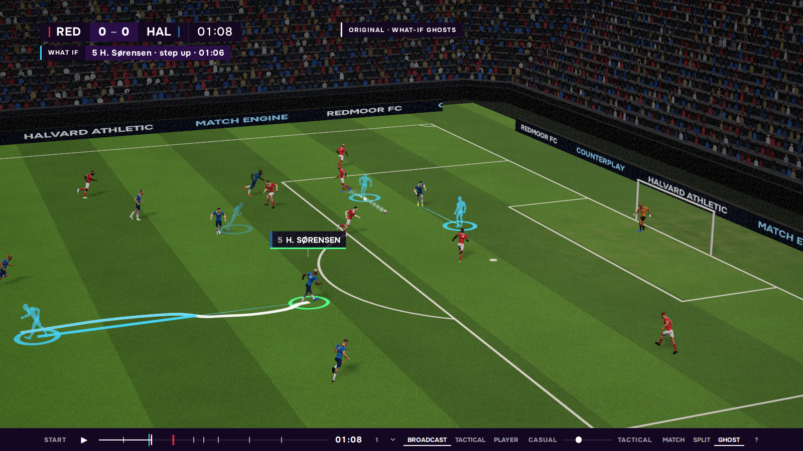
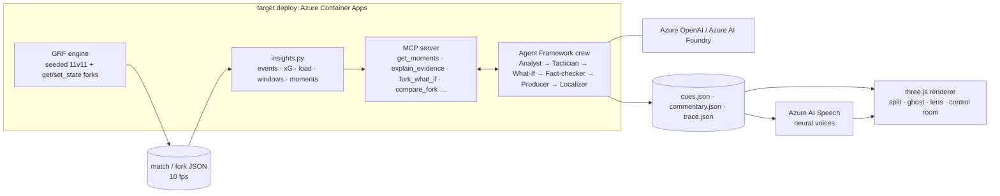

# Counterplay

**Every match, every fan, every what-if.** Counterplay is an AI broadcast that explains a football match in your language and at your level. It can also rewind any moment and replay it with one decision changed.



*What if Halvard's centre-back had stepped up at 01:06? The engine re-simulates from that exact state. The ghosts show the original match, and Redmoor's opener never happens (1-0 becomes 0-0).*

## The pipeline

| stage | what happens | code |
|---|---|---|
| **Ingest** | Google Research Football (GRF) plays a full 11v11 match on its builtin AI. The run is deterministic for a given seed and recorded at 10 fps: positions, ball, possession and score. GRF snapshots its full state, so any moment can be forked: one player gets one tweak (`step_up`, `hold_line`, `sprint`, `pass_early`, `shoot`) and the engine re-simulates from there. | `engine/sim.py` |
| **Interpret** | Events (passes, shots, tackles, goals) and metrics are derived from the frames: pass difficulty, xG, sprints, synthetic heart rate, possession, line height, pressing and control vs chaos. Moments are ranked, each with evidence. | `engine/insights.py` |
| **Explain** | A Microsoft Agent Framework crew reads the match only through MCP tools. The Analyst picks what matters, the Tactician explains why, and the What-If agent forks the key moment. The Fact-checker re-verifies every number against tool output. | `engine/mcp_server.py`, `agents/crew.py` |
| **Render** | A three.js broadcast renderer shows split and ghost what-if views, a casual-to-tactical lens, camera cuts and captions. A director cue JSON drives it. | `web/` |
| **Personalize** | The Producer and Localizer write a cue script and commentary per persona (casual, analyst, or one player in the second person) and language (en, es, tr, de). Azure AI Speech voices it. | `agents/crew.py`, `agents/voice.py` |



## Agent crew

| agent | role | main tools |
|---|---|---|
| Analyst | picks the moments that matter for this persona | `get_moments`, `explain_evidence`, `get_player` |
| Tactician | explains why: possession, control vs chaos, pressing, line height, line-breaking passes | `get_window_stats` |
| What-If | reuses or creates a fork of the key moment, then reports the score in both versions at the same match time | `list_forks`, `fork_what_if`, `compare_fork`, `get_match_state` |
| Fact-checker | checks every number against tool output and re-reads the what-if score pair from both matches; anything unverified does not air | `get_match_state`, plus the evidence store |
| Producer | decides what airs and when, and writes director cues (cuts, lens, slow-mo, split/ghost, captions) | – |
| Localizer | writes commentary and captions in the persona's language and voice | – |

Each agent has a timeout and one retry. If it still fails, a deterministic template takes over, built from the same MCP tools. That template path is also how the crew runs without Azure credentials. Every handoff, tool call and fallback is written to `trace.json`, and the web "control room" strip replays it. `--kill <agent>` crashes an agent on purpose to demo the recovery.

## Quickstart

GRF needs Python 3.9 and the agents need Python 3.12, so they use separate environments. Exact setup commands are in [`engine/README.md`](engine/README.md) and [`agents/README.md`](agents/README.md).

```bash
cd engine && $GRF_PY sim.py --seed 42 --steps 3000 --out ../data/match.json             # base match (~20 s)
$GRF_PY sim.py --fork ../data/match.json --at 66.5 --tweak step_up --player a6 --out ../data/fork-step_up.json
$MCP_PY insights.py ../data/match.json                                                     # interpret
cd ../agents && $AGENT_PY crew.py --match match --persona casual --lang en                 # explain + personalize
cd ../web && npm install && npm run dev    # open /?cues=/data/match.casual.en.cues.json&control=1
```

Azure is optional. Put `AZURE_OPENAI_ENDPOINT` / `AZURE_OPENAI_DEPLOYMENT` / `AZURE_OPENAI_API_KEY` (or `FOUNDRY_PROJECT_ENDPOINT` / `FOUNDRY_MODEL`) and `AZURE_SPEECH_KEY` / `AZURE_SPEECH_REGION` in `.env`. Without them, the crew runs in template mode and voice is skipped.

## Data and licensing

- **Synthetic data only.** Matches come from [Google Research Football](https://github.com/google-research/football) (Apache-2.0), simulated on its builtin AI.
- **Fictional clubs and players.** Redmoor FC and Halvard Athletic, and every player name, are made up.
- **No real league data.** No Premier League data, footage, names or marks are used.
- **Synthetic heart rate.** It is derived from running load and labelled as synthetic everywhere it appears.
- **License.** Code is MIT ([LICENSE](LICENSE)). GRF itself remains Apache-2.0.
